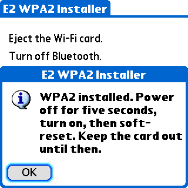
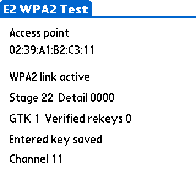

# palmOne SDIO WPA2 for Tungsten E2

Adds WPA2-Personal with CCMP to the palmOne SDIO Wi-Fi card on the Tungsten E2. The tested card reports NIC ID `801D`, primary firmware `1.1.2`, and station firmware `1.8.0`.

[Download the latest release](https://github.com/palmsnipe/palm-wifi-sdio/releases/latest) · [Installation, compatibility and rollback](doc/palmone-e2-wpa2.md)

Download **E2WPA2Patcher.prc** from the release assets and transfer it directly to an E2 with the stock palmOne v1.2 Wi-Fi software installed. The app applies both WPA2 patches and installs the status app. It can also restore the stock driver and Setup panel. [Single-PRC installation steps](doc/palmone-e2-wpa2.md#install-from-a-single-prc)

The release ZIP also includes the desktop patcher, the patch payloads, and their source. Run the desktop patcher with your original `WiFi_Installer1.2.prc` to generate the Palm OS install and stock rollback files.

For development, keep your copy of the installer at `local/WiFi_Installer1.2.prc`. The `make package` target uses it by default. Git ignores `local/` and the release ZIP excludes it.

| Install WPA2 | Connected to the simulated AP | Restore Stock |
| --- | --- | --- |
|  |  |  |

Screenshots from an emulated Tungsten E2. The single-PRC flow passed installation, reboot, WPA2 association, DHCP, and stock restore in CloudpilotEmu.

On a physical E2, both v0.8 installation paths reached Stage 22 / Detail 0000, obtained an IP address, and restored stock Wi-Fi after reset. This includes the downloadable `E2WPA2Patcher.prc`. The earlier v0.7 tests also covered ping, group rekeying, and Forget. [Physical test results](doc/palmone-e2-wpa2.md#physical-results)

This repository owns the physical E2 driver patch and builds the installable release. The [CloudpilotEmu fork](https://github.com/palmsnipe/cloudpilot-emu) owns the virtual SDIO card, simulated AP and emulator test fixtures. See [LICENSE](LICENSE) and the third-party notices in the source tree.

[Maintenance guide](doc/maintenance.md) · [GitHub Actions release process](doc/releasing.md)
