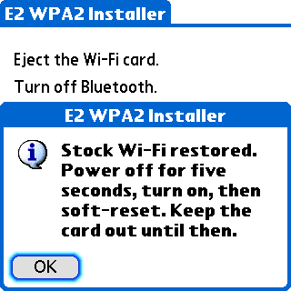

# palmOne SDIO WPA2 for Tungsten E2

Adds WPA2-Personal with CCMP to the palmOne SDIO Wi-Fi card on the Tungsten E2. The tested card reports NIC ID `801D`, primary firmware `1.1.2`, and station firmware `1.8.0`.

[Download v0.7](https://github.com/palmsnipe/palm-wifi-sdio/releases/tag/v0.7) · [Installation, compatibility and rollback](doc/palmone-e2-wpa2.md)

The release ZIP includes the patcher, the patch payloads, and their source. Run the patcher with your original `WiFi_Installer1.2.prc` to generate the Palm OS install and stock rollback files. The patcher checks the installer and its driver and panel resources.

For development, keep your copy of the installer at `local/WiFi_Installer1.2.prc`. The `make package` target uses it by default. Git ignores `local/` and the release ZIP excludes it.

To transfer a single PRC to the Tungsten E2, build it with `make installer`. It installs both WPA2 patches and the status app, and can restore the stock driver and Setup panel. [Single-PRC installation steps](doc/palmone-e2-wpa2.md#install-from-a-single-prc)

| Install WPA2 | Connected to the simulated AP | Restore Stock |
| --- | --- | --- |
|  |  |  |

Screenshots from an emulated Tungsten E2. The single-PRC flow passed installation, reboot, WPA2 association, DHCP, and stock restore in CloudpilotEmu. Physical test results below refer to the v0.7 driver.

On the physical E2, v0.7 connected to a local network and a separate bench AP. The bench test verified DHCP, ping, and two group key rotations. Forget and stock rollback also passed on the device.

This repository owns the physical E2 driver patch and builds the installable release. The [CloudpilotEmu fork](https://github.com/palmsnipe/cloudpilot-emu) owns the virtual SDIO card, simulated AP and emulator test fixtures. See [LICENSE](LICENSE) and the third-party notices in the source tree.

[Maintenance guide](doc/maintenance.md) · [GitHub Actions release process](doc/releasing.md)
